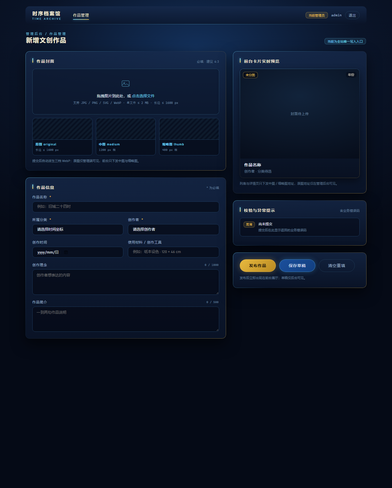
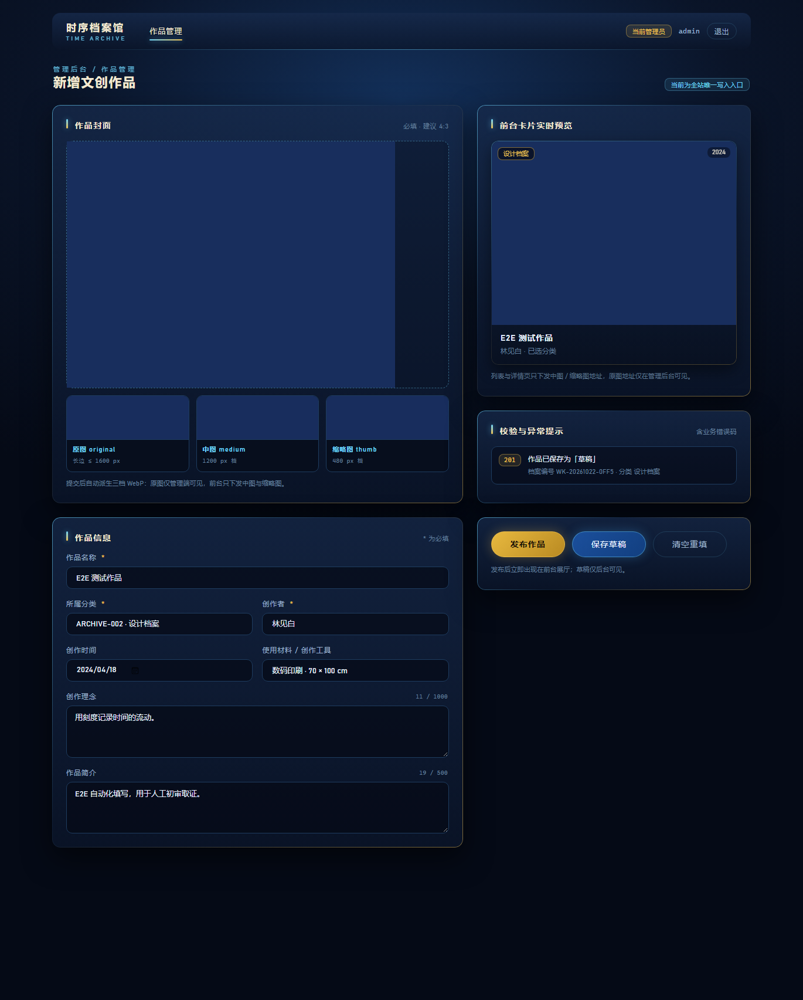
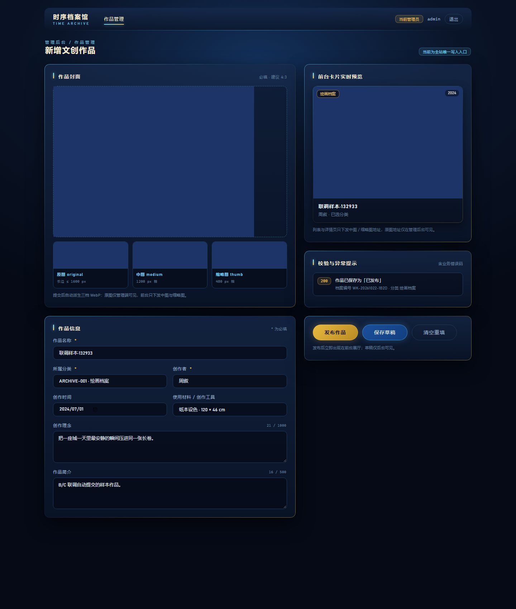
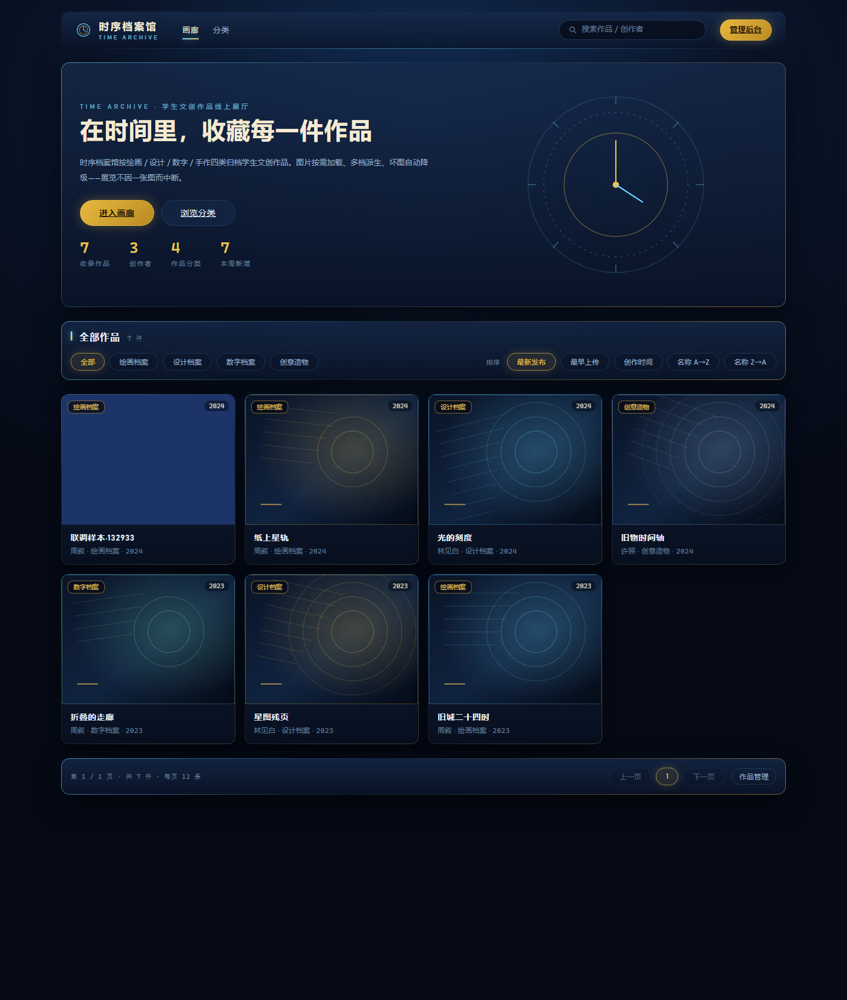
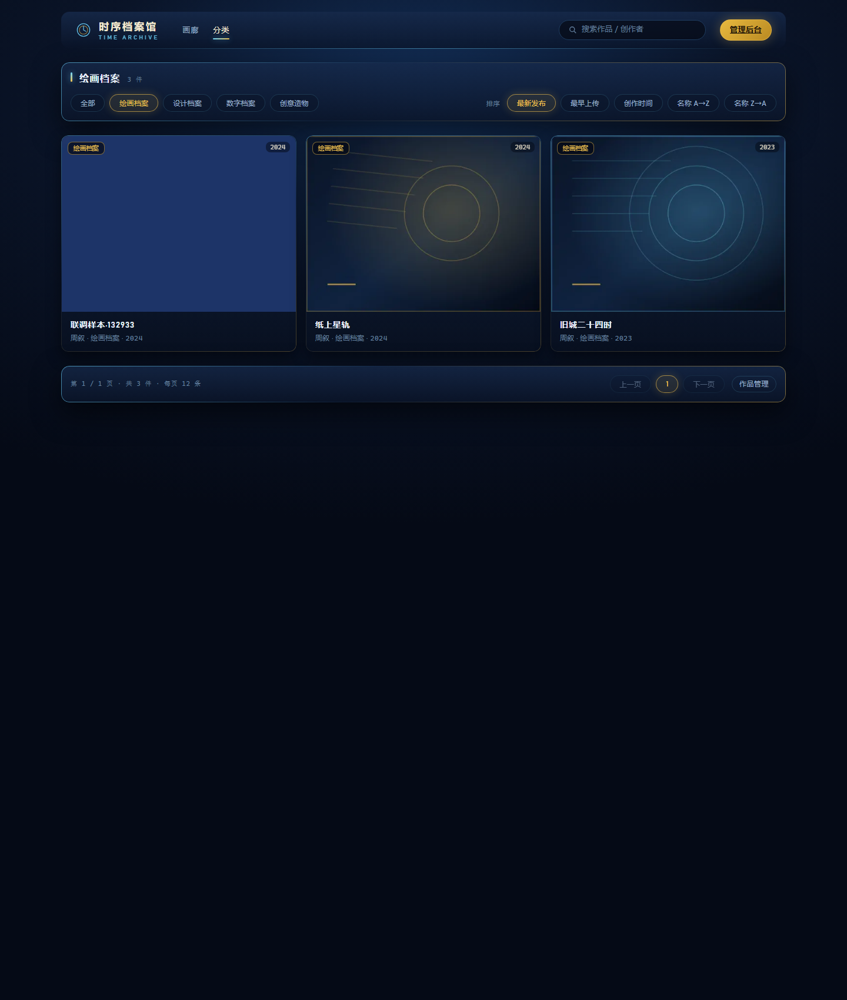
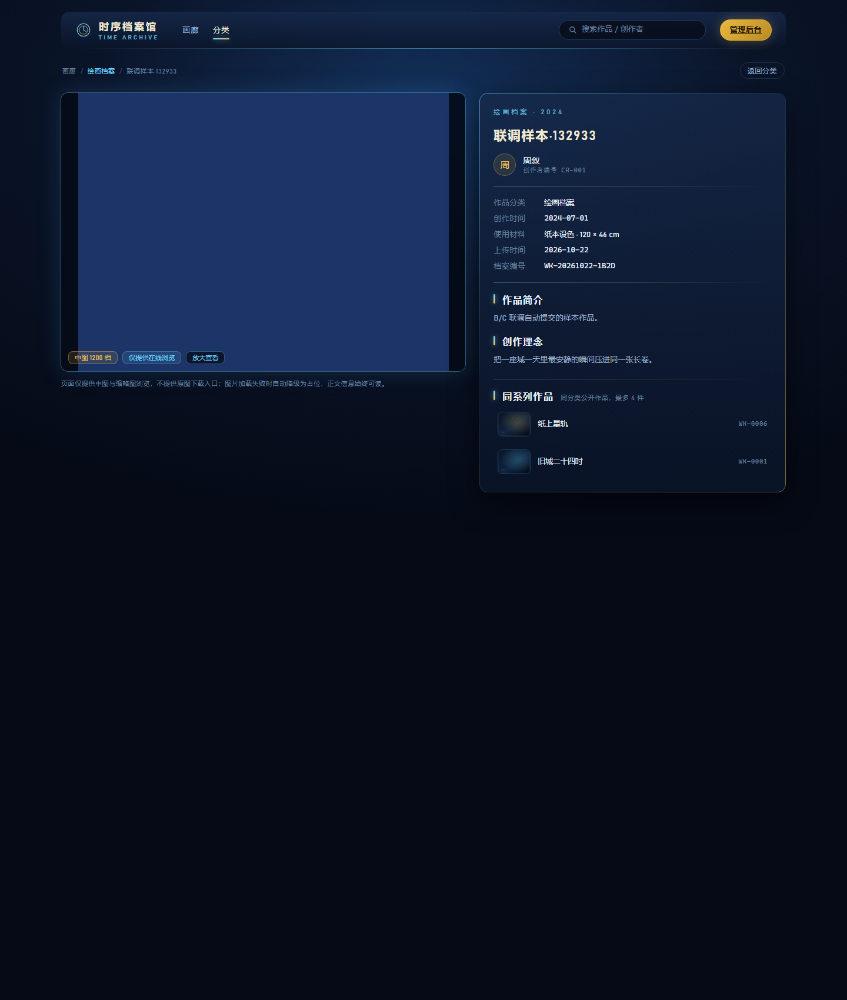
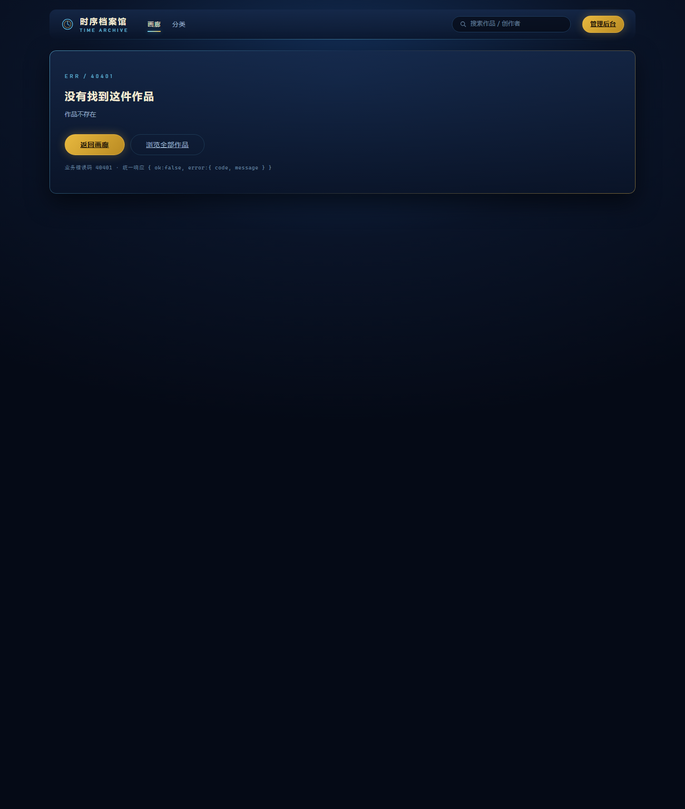

# 时序档案馆 TIME ARCHIVE

学生文创作品线上展厅网页（Vibe-Coding 实验4 · 实训题 3）
**已实现范围：子任务 A + B + C，并完成三者联调**

| 子任务 | 内容 | 状态 |
| --- | --- | --- |
| A | 管理员新增作品后端接口 `POST /api/admin/works` + 前端作品上传表单页 | 已实现 · 23 条用例通过 |
| B | 获取分类作品列表 `GET /api/works` + 画廊首页 / 分类列表页 | 已实现 · 47 条用例通过 |
| C | 获取单条作品详情 `GET /api/works/:id` + 作品详情页（含灯箱） | 已实现 · 47 条用例通过 |
| — | A→B→C 整体联调（上传→入库→画廊→详情→异常） | 26 个检查点通过 |

- 学生：毕楚晗　学号：js24060301
- 上游依据：实验1 PRD 定稿 · 实验2 技术方案定稿 · 实验3 接口文档 / UI 规范
- 边界：仅「访客 + 管理员」两种角色，前台只读、后台唯一写入（N05 / N07 未被突破）

---

## 一、快速启动

```bash
npm install     # 首次
npm start       # http://localhost:3000
```

| 入口 | 地址 | 说明 |
| --- | --- | --- |
| 画廊首页 | <http://localhost:3000/> | Hero + 全部作品 + 分类 / 排序 |
| 分类列表 | <http://localhost:3000/works?cat=ARCHIVE-001> | 支持 `cat` / `q` / `sort` / `page` |
| 作品详情 | `/works/{作品编号}` | 从画廊点卡片进入 |
| 管理后台 | <http://localhost:3000/admin/upload> | 需登录：`admin` / `admin12345` |

首次启动自动创建 `data/archive.db` 并写入种子数据：4 分类、3 创作者、8 件作品（6 已发布 / 1 草稿 / 1 下架）、1 个管理员。

```bash
npm run seed          # 核对种子数据（幂等，只打印不写入）
npm run seed:covers   # 生成 8 件种子作品的演示封面（占位图，已存在则跳过）
npm run test:a        # 子任务 A：23 条
npm run test:bc       # 子任务 B / C：47 条
npm run test:all      # A + B/C 一起跑
npm run e2e           # 真浏览器整体联调（自带服务，端口 3200，26 个检查点）
```

> 换端口：`PORT=3100 npm start`（Windows：`set PORT=3100 && npm start`）。

---

## 二、技术栈

| 项 | 选型 | 说明 |
| --- | --- | --- |
| 运行时 | Node.js ≥ 18（实测 22.22.2） | 单进程单机 |
| Web | Express 4 | 页面 + 接口 + 静态资源同源 |
| 模板 | EJS | 服务端渲染，接口与页面同源同一套 service |
| 数据库 | `node:sqlite`（内置） | 免原生编译，WAL 模式 |
| 上传 | multer（内存存储，限 2MB） | 单文件字段 `coverImage` |
| 图片 | sharp | 校验 + 三档 WebP 派生 |
| 鉴权 | httpOnly Cookie + 进程内会话 | 免额外依赖 |

---

## 三、目录结构（按 BE 模块划分）

```
time-archive/
├── app.js                        # 入口：中间件装配 + 路由挂载
├── config/
│   ├── constants.js              # 路径 / 图片规格 / 字段上限 / 会话
│   └── errors.js                 # 19 条业务错误码总表 + AppError
├── db/
│   ├── index.js                  # BE-08 数据访问（4 表 + 种子 + 事务）
│   └── seed.js                   # 种子核对脚本（npm run seed）
├── modules/
│   ├── BE-01/validate.js         # 写接口校验（40001/40002/40003）
│   ├── BE-01/query.validate.js   # 读接口校验（40001/40002/40003/40004/40005）★B
│   ├── BE-02/work.service.js     # 唯一写入口（新增作品）
│   ├── BE-03/work.query.service.js # 列表 / 详情 / 统计（只读）★B ★C
│   ├── BE-04/category.service.js
│   ├── BE-05/creator.service.js
│   ├── BE-06/auth.service.js     # 管理员登录 / 会话
│   └── BE-07/image.service.js    # 魔数校验 + 三档派生 + 原子落盘
├── middlewares/                  # 鉴权 / 上传 / 统一错误
├── routes/
│   ├── admin.works.js            # ★A  POST /api/admin/works
│   ├── works.js                  # ★B ★C  GET /api/works · /api/works/:id
│   ├── auth.js · meta.js
│   ├── public.pages.js           # 前台页面：/ · /works · /works/:id
│   └── pages.js                  # 后台页面：/admin/login · /admin/upload
├── views/
│   ├── gallery.ejs               # 画廊首页 + 分类列表（同一模板，isHome 切换）
│   ├── detail.ejs                # 作品详情 + 灯箱
│   ├── error.ejs                 # 40401 / 40301 / 400xx 错误页
│   ├── upload.ejs · login.ejs
│   └── partials/topbar.ejs · card.ejs
├── public/
│   ├── css/tokens.css            # 实验3 设计令牌（原样沿用）
│   ├── css/upload.css · gallery.css · detail.css   # 只做排版
│   ├── js/upload.js · gallery.js
│   └── uploads/works/{id}/       # 三档图片落盘目录
├── test/
│   ├── subtask-a.test.js         # A：23 条
│   └── subtask-bc.test.js        # B/C：47 条（自带 fixture 并自动清理）
├── scripts/
│   ├── seed-covers.js            # 种子演示封面生成
│   ├── e2e-full.js               # A+B+C 整体联调（Edge + CDP）
│   ├── e2e-ui.js · snapshot.js · install.js · debug-preview.js
└── docs/screenshots/             # 01~04（A）+ 05~10（联调）
```

---

## 四、接口契约

统一响应：成功 `{ ok:true, data }`；失败 `{ ok:false, error:{ code, message } }`。
**公开接口一律不返回 `status` 与 `coverImage`（original 原图地址）**——草稿与已下架作品对前台不可见。

### 4.1 接口一 `POST /api/admin/works`　管理员

入参 9 项（multipart）：`coverImage`（JPG/PNG/SVG/WebP，≤2MB，长边≤1600px）、`title`（1~60 字）、`authorId`、`categoryId`（ARCHIVE-001~004）、`description`（≤500）、`concept`（≤1000）、`materials`（≤200）、`createdAt`（YYYY-MM-DD）、`status`（draft/published，默认 draft）。
返回 14 项：`id`、`title`、`authorId`、`categoryId`、`categoryName`、`coverImage`、`coverMedium`、`coverThumb`、`description`、`concept`、`materials`、`createdAt`、`uploadedAt`、`status`。

### 4.2 接口二 `GET /api/works`　公开

| 参数 | 取值 | 非法时 |
| --- | --- | --- |
| `cat` | ARCHIVE-000（默认，全部）/ 001~004 | 40003 |
| `q` | ≤50 字，匹配作品名 / 创作者名 / 简介 / 材料 | 40002 |
| `sort` | latest（默认）/ earliest / created / name_asc / name_desc | 40005 |
| `page` | ≥1，默认 1；**每页固定 12 条** | 40001 / 40004 |

返回 `total`、`page`、`pageSize`、`totalPages`、`items[10 项]`（`id/title/categoryId/categoryName/authorId/authorName/coverMedium/coverThumb/uploadedAt/createdAt`）。
无结果返回 `total=0` 与空数组，前端展示「未发现符合条件的档案，请尝试其他关键词」。

### 4.3 接口三 `GET /api/works/:id`　公开

返回 13 项：`id`、`title`、`categoryId`、`categoryName`、`author{id,name}`、`coverMedium`、`coverThumb`、`description`、`concept`、`materials`、`createdAt`、`uploadedAt`、`related[≤4]{id,title,coverThumb}`。
不存在 → **40401**；草稿 / 已下架 → **40301**（两者语义分开，便于前端提示不同文案）。

### 4.4 错误码（本工程已实现 11 条 + 读接口 4 条）

| 码 | HTTP | 场景 | 实现位置 |
| --- | --- | --- | --- |
| 40001 | 400 | 必填缺失 / 格式非法 / 参数重复 | `BE-01/validate.js`、`query.validate.js` |
| 40002 | 400 | 字段或关键词超长 | 同上 |
| 40003 | 400 | 分类编号不存在 | `BE-01` + `BE-04` |
| 40004 | 400 | 页码 < 1 | `query.validate.js` |
| 40005 | 400 | 排序方式不支持 | `query.validate.js` |
| 40101 / 40102 | 401 | 未登录 / 账号密码错误 | `middlewares/auth.js`、`BE-06` |
| 40301 | 403 | 作品未公开 | `BE-03` |
| 40401 / 40402 | 404 | 作品不存在 / 创作者不存在 | `BE-03`、`BE-02` |
| 41301 / 41501 / 42201 / 42202 | 413/415/422 | 体积 / 类型 / 魔数 / 尺寸 | `BE-07` |
| 50001 / 50002 | 500 | 图片处理失败 / 写库·查询失败 | `BE-07`、`BE-02`、`BE-03` |

---

## 五、图片三档派生

| 档位 | 文件名 | 长边 | 用在哪 |
| --- | --- | --- | --- |
| original | `cover-original.webp` | ≤1600px | 仅管理端返回，前台不下发 |
| medium | `cover-medium.webp` | 1200px | 详情页大图 / 灯箱 |
| thumb | `cover-thumb.webp` | 480px | 列表卡片 / 相关作品 |

落盘目录 `public/uploads/works/{workId}/`；数据库只存 original 地址，另两档按命名约定推导。
**原子性**：三档先写 `.tmp` 再逐个 rename；任一步失败清理整目录并返回 50001。

---

## 六、界面

| 01 上传页空态 | 03 保存成功 |
| --- | --- |
|  |  |

| 05 联调：上传成功 | 06 联调：画廊首页 |
| --- | --- |
|  |  |

| 07 联调：分类列表 | 08 联调：作品详情 |
| --- | --- |
|  |  |

| 09 联调：图片灯箱 | 10 联调：错误页（40401） |
| --- | --- |
|  |  |

- 配色、圆角、投影全部取自 `public/css/tokens.css`（深空蓝 `#050A16` + 青 `#6FD8FF` + 金 `#F2C14E`），三个页面 CSS 只做排版，无自造色值。
- 图片加载失败统一兜底：卡片切站内占位 + 「查看作品」，详情页切占位但正文仍可读。
- **种子作品的封面是 `npm run seed:covers` 生成的抽象占位图**（深蓝渐变 + 计时环线稿），不是真实学生作品图片。

---

## 七、本仓库不包含的部分

以下不在本次三个子任务（三个 ★ 接口）范围内，**未实现**：

- 管理员编辑 / 状态流转 / 删除作品（接口 4~6，看板 T-19 / T-20，P1）
- `GET /api/creators/:id` 创作者详情接口（接口 8，看板 T-12；契约未给出返回明细，未擅自定字段）
- 评论、点赞、收藏、浏览量、下单、统计等越界功能（N01~N09 边界）
- 灯箱只放大中图，**不提供原图与下载入口**（契约 §五 明确要求）

---

## 八、验收结果（实测）

| 命令 | 用例数 | 结果 |
| --- | --- | --- |
| `npm run test:a` | 23 | 23 通过 / 0 失败 |
| `npm run test:bc` | 47 | 47 通过 / 0 失败 |
| `npm run e2e` | 26 | 26 通过 / 0 失败 |

`npm run e2e` 的真实链路（Edge + CDP，非模拟）：登录 → 上传页 → `DOM.setFileInputFiles` 选真实图片 → 点「发布作品」→ 200 + 档案编号 → 三档落盘 → 画廊首页出现 → 分类页筛选 → 检索命中 → 点卡片进详情 → 灯箱放大/Esc 关闭 → 40401 / 40003 / 40001 / 40005 / 40301 五种异常。
